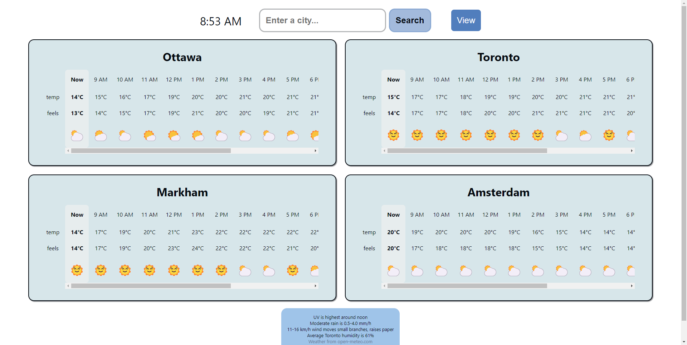
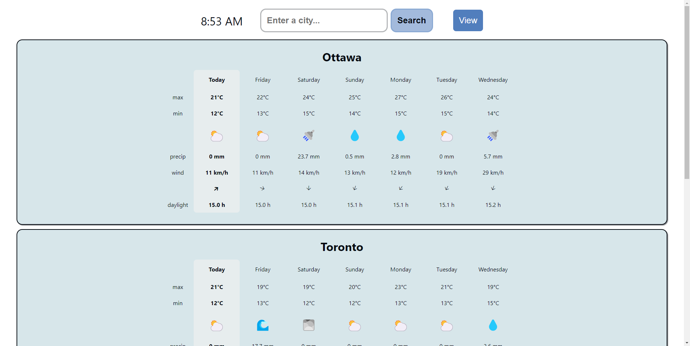
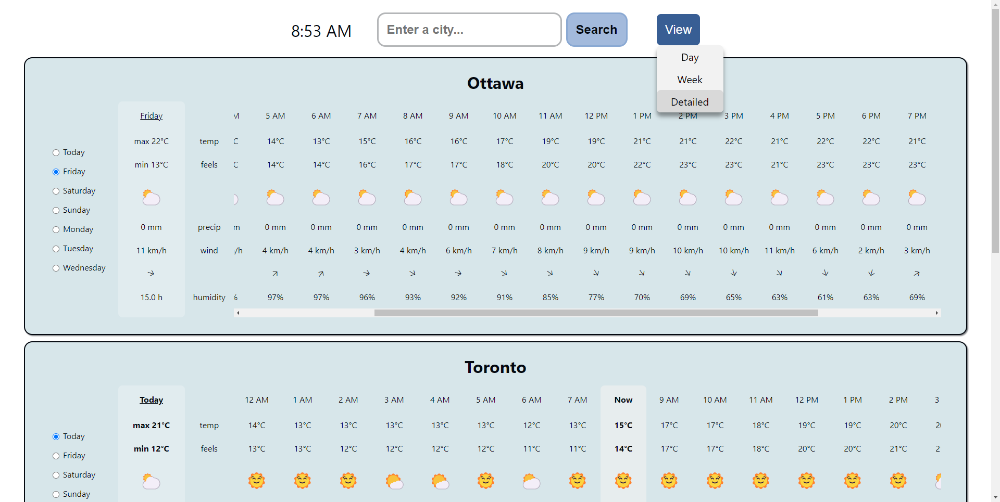

## Why weather?

The weather is important for when I go outside so I know what to wear and if I can play frisbee

## The app features...

- 3 different display modes (day, week, detailed)
- Current conditions for every city: feels like, high/low, wind and gusts, rain chance, humidity, UV, sunrise/sunset, air quality
- Heads-ups for the next 12 hours: rain or snow coming, gusty wind, high UV, big temperature swings, and whether it's frisbee weather
- What to wear, based on the feels-like temperature
- Search for weather by city (add a province or country to narrow it down, e.g. "London, ON"), or use my location
- Remembers my last searched city and view
- Times are local to each city, and data refreshes on its own if the tab stays open
- Digital clock with the date
- Dark mode that follows the system setting
- Works on phones

## How it works

1. App component contains components
2. Card components receive location from Search component (there are default cities set), which uses a geocoding API to convert city name to latitude and longitude
3. Card components get weather data from the useGetWeather hook, which fetches everything for a city in one request (plus air quality) and caches it for 10 minutes so switching views is instant
4. Weather information is shown!

## What I did

- Fetched and displayed responsive weather information from APIs with React
- Implemented state control and relevant hooks for seamless data flow between components
- Designed a user-friendly interface using HTML and CSS that adapts to varying screen sizes

## Gallery

